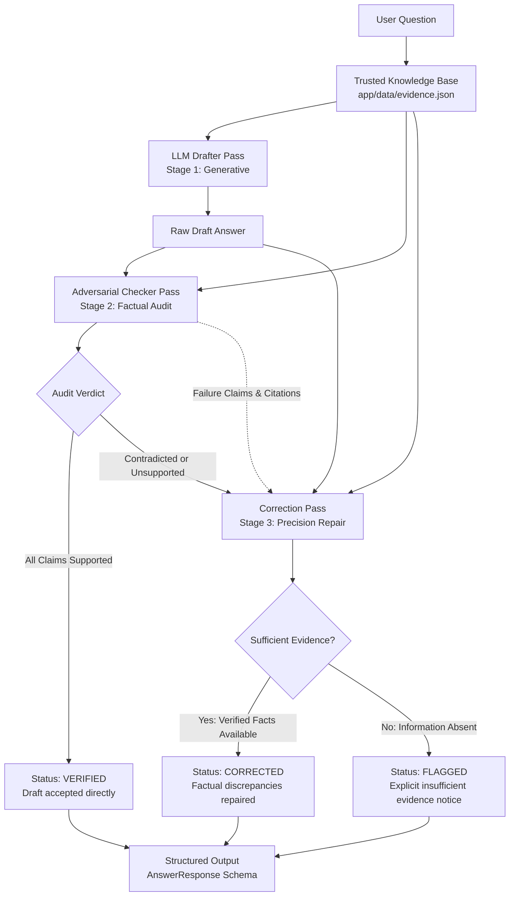

# EvidenceGuard AI — A Self-Checking Factual Answer Engine

[](https://www.python.org/)
[](https://fastapi.tiangolo.com/)
[](https://docs.pytest.org/)
[](LICENSE)

> **Submission for the Protofine.ai Applied AI Engineering Intern Build Task**  
> *Theme: Applied AI Engineering — The Self-Check Loop*

---

## 1. What I Built

**EvidenceGuard AI** is a targeted factual verification system designed for a single, high-stakes failure mode: **unsupported or fabricated factual claims** in AI-generated answers. Given a user query and a trusted local evidence base, the engine first drafts a natural response using an LLM. It then runs an independent, adversarial second pass that audits the draft claim-by-claim strictly against the provided evidence, classifying each statement as supported, unsupported, or contradicted. If errors are caught, the system executes an automated correction pass that either repairs the answer using verified facts or safety-flags the query as unanswerable—ensuring ungrounded statements never silently reach the end user.

---

## 2. Why This Failure Mode

Large language models routinely generate fluent, confident prose that contains subtle, believable factual errors. In domain-specific applications (legal, financial, enterprise search, infrastructure telemetry), fluent fabrications are far more dangerous than obvious nonsense because human reviewers instinctively trust them.

> [!IMPORTANT]  
> **Explicit Scope Boundary:** This system does **not** claim to solve "hallucinations" generally, nor does it attempt to verify universal truth or ethical alignment.  
> **"This system only attempts to detect unsupported factual claims against supplied evidence."**

By constraining the problem to grounding verification against explicit, supplied source records, we turn an intractable philosophical problem into a deterministic, auditable engineering loop.

---

## 3. Architecture



### Component Responsibilities

1. **Trusted Evidence Base (`app/data/evidence.json`)**: 10 deterministic records for a fictional cloud data platform (*NovaTech* and its core product *NovaSync*). Serves as the sole source of ground truth.
2. **LLM Provider Abstraction (`app/llm/`)**: Decoupled interface (`LLMProvider`) supporting live OpenAI models (`OpenAIProvider`) and offline deterministic testing (`MockLLMProvider`).
3. **Stage 1: Drafter Service (`app/services/drafter.py`)**: Prompted constructively to answer the question using evidence while returning clean JSON. Preserves raw draft output without artificial filtering.
4. **Stage 2: Adversarial Checker (`app/services/checker.py`)**: Skeptical auditor. Deconstructs the draft into atomic factual claims, locates supporting/contradicting clauses in the evidence, classifies each as `supported`, `unsupported`, or `contradicted`, cites source IDs, and explains its rationale.
5. **Stage 3: Precision Corrector (`app/services/corrector.py`)**: Invoked only when Stage 2 fails. Excises unsupported claims, resolves contradicted facts against evidence citations, and refuses to extrapolate if evidence is insufficient (producing `flagged` status).
6. **Pipeline Coordinator (`app/services/pipeline.py`)**: Orchestrates the 3-stage loop, calculates execution latency, logs audit trails, and returns a comprehensive structured schema.
7. **FastAPI Web Service (`app/main.py`, `app/routes.py`)**: REST endpoints (`/health`, `/evidence`, `/answer`) and interactive Swagger UI (`/docs`).
8. **Developer Demo UI (`app/static/index.html`)**: Sleek browser interface to trigger test scenarios, view claim chips, and review draft diffs in real time.

---

## 4. How It Works

The engine enforces a strict cognitive separation between generation and verification:

1. **Evidence Grounding**: The pipeline receives the question and retrieves the relevant evidence records from `evidence.json`.
2. **First Pass (Generation)**: The Drafter synthesizes an answer. If the LLM confuses a detail or slips into confident extrapolation, the error enters the draft unvarnished.
3. **Second Pass (Verification)**: The Checker receives the question, raw draft, and evidence. Under an adversarial persona (`[ROLE: CHECKER]`), it extracts individual propositions and maps each to evidence records.
4. **Deterministic Gate**: If any claim is labeled `unsupported` or `contradicted`, a Python-level safety rule forces `check.passed = False`, overriding any model hallucination.
5. **Third Pass (Resolution)**:
   - If `passed == True`: The draft is marked `verified` and returned.
   - If `passed == False`: The Corrector resolves the identified discrepancies using explicit evidence text. If the evidence provides zero coverage for the question, it refuses to guess and outputs `flagged`.

---

## 5. Running Locally

### Prerequisites
- Python 3.11+ or Python 3.13
- Git

### Step-by-Step (Windows PowerShell)

1. **Clone the repository and enter the directory**:
   ```powershell
   git clone <repo-url>
   cd Protofine
   ```

2. **Create and activate a virtual environment**:
   ```powershell
   python -m venv .venv
   .\.venv\Scripts\Activate.ps1
   ```

3. **Install dependencies**:
   ```powershell
   pip install -r requirements.txt
   ```

4. **Configure environment**:
   ```powershell
   copy .env.example .env
   ```
   *(By default, `LLM_PROVIDER=mock`, enabling full offline execution without needing an OpenAI API key. To run with live OpenAI models, set `LLM_PROVIDER=openai` and add your `OPENAI_API_KEY` in `.env`)*

5. **Start the FastAPI server**:
   ```powershell
   python -m uvicorn app.main:app --reload --port 8000
   ```

6. **Open in your browser**:
   - Interactive Swagger API Documentation: [http://127.0.0.1:8000/docs](http://127.0.0.1:8000/docs)
   - Developer Demo Web Interface: [http://127.0.0.1:8000/](http://127.0.0.1:8000/)

---

## 6. Environment Variables

Defined in `.env.example`:

| Variable | Default | Description |
|---|---|---|
| `LLM_PROVIDER` | `mock` | `mock` for deterministic local testing; `openai` for live model |
| `OPENAI_API_KEY` | *(empty)* | Official OpenAI API Key (required only if `LLM_PROVIDER=openai`) |
| `MODEL_NAME` | `gpt-4o-mini` | Target OpenAI model name |
| `HOST` | `127.0.0.1` | Local host interface |
| `PORT` | `8000` | Port for FastAPI server |
| `LOG_LEVEL` | `INFO` | Application log level (`DEBUG`, `INFO`, `WARNING`, `ERROR`) |

---

## 7. API Example

### Request
```http
POST /api/v1/answer HTTP/1.1
Host: 127.0.0.1:8000
Content-Type: application/json

{
  "question": "Who founded NovaTech and what year did they start?",
  "evidence_ids": ["novatech-001"]
}
```

### Response (Intentional Plausible Failure $\rightarrow$ Corrected)
```json
{
  "question": "Who founded NovaTech and what year did they start?",
  "evidence_used": [
    {
      "source_id": "novatech-001",
      "title": "Company Founding & Leadership",
      "content": "NovaTech was founded in October 2019 by Dr. Priya Shah and Marcus Vance. The company is headquartered in Seattle, Washington."
    }
  ],
  "draft": {
    "answer": "NovaTech was founded in October 2018 by Dr. Priya Shah and Marcus Vance in Seattle, Washington.",
    "model": "mock-gpt-4o-mini"
  },
  "check": {
    "passed": false,
    "failure_type": "contradicted_fact",
    "claims": [
      {
        "claim": "NovaTech was founded in October 2018",
        "status": "contradicted",
        "evidence_ids": ["novatech-001"],
        "reason": "Evidence explicitly states NovaTech was founded in October 2019, contradicting the draft's claim of 2018."
      },
      {
        "claim": "NovaTech was founded by Dr. Priya Shah and Marcus Vance",
        "status": "supported",
        "evidence_ids": ["novatech-001"],
        "reason": "Corroborated by source novatech-001."
      },
      {
        "claim": "NovaTech is headquartered in Seattle, Washington",
        "status": "supported",
        "evidence_ids": ["novatech-001"],
        "reason": "Corroborated by source novatech-001."
      }
    ]
  },
  "final": {
    "status": "corrected",
    "answer": "NovaTech was founded in October 2019 by Dr. Priya Shah and Marcus Vance in Seattle, Washington.",
    "correction_notes": "Corrected founding year from 2018 to 2019 based on source novatech-001."
  }
}
```

---

## 8. Test Cases & Execution Results

All 6 mandatory scenarios were executed using pytest. Here are the **actual execution results**:

| # | Scenario | Draft Behavior | Checker Audit | Final Status & Answer |
|---|---|---|---|---|
| **1** | Clean Supported (Founding) | Stated founding in Oct 2019 by Priya Shah & Marcus Vance in Seattle | **PASSED** (All claims `supported`) | `verified` — Draft accepted directly |
| **2** | Clean Supported (Pricing) | Stated Standard tier is $499/mo per cluster up to 5 worker nodes | **PASSED** (All claims `supported`) | `verified` — Draft accepted directly |
| **3** | **Plausible Wrong Draft (Primary Demo)** | Confidently stated founding in **October 2018** | **FAILED** (`contradicted_fact` against `novatech-001`) | `corrected` — Founding year restored to **2019** |
| **4** | Contradicted Platform Claim | Asserted NovaSync supports Windows Server in production | **FAILED** (`contradicted_fact` against `novatech-003`) | `corrected` — Clarified Windows Server is private preview only |
| **5** | Unanswerable / Insufficient Evidence | Hallucinated $15M ARR and $95M valuation in 2024 | **FAILED** (`unsupported_fact`, 0 source matches) | `flagged` — States evidence contains no revenue metrics; refused to guess |
| **6** | Multi-Claim with 1 Hallucinated Fact | Listed Rust, Go, PostgreSQL + fabricated Ruby on Rails dashboard | **FAILED** (`unsupported_fact` for Ruby on Rails) | `corrected` — Excised Ruby on Rails; preserved Rust, Go, & PostgreSQL |

### Running the Test Suite
```powershell
python -m pytest -v
```
**Actual Test Run Output:**
```
tests/test_api.py::test_health_endpoint PASSED                           [  5%]
tests/test_api.py::test_list_evidence_endpoint PASSED                    [ 10%]
tests/test_api.py::test_answer_endpoint_successful_pipeline PASSED       [ 15%]
tests/test_api.py::test_answer_endpoint_unknown_evidence_id_returns_404 PASSED [ 20%]
tests/test_api.py::test_answer_endpoint_empty_question_returns_422 PASSED [ 25%]
tests/test_api.py::test_root_serves_html_ui PASSED                       [ 30%]
tests/test_checker.py::test_clean_json_text_markdown_stripping PASSED    [ 35%]
tests/test_checker.py::test_checker_all_claims_supported PASSED          [ 40%]
tests/test_checker.py::test_checker_detects_contradicted_claim PASSED    [ 45%]
tests/test_checker.py::test_checker_detects_unsupported_claim PASSED     [ 50%]
tests/test_checker.py::test_checker_safety_rule_overrides_hallucinated_passed PASSED [ 55%]
tests/test_checker.py::test_checker_malformed_json_fails_safely PASSED   [ 60%]
tests/test_failure_demo.py::test_intentional_failure_story_reproducibility PASSED [ 65%]
tests/test_pipeline.py::test_scenario_1_clean_supported_founding PASSED  [ 70%]
tests/test_pipeline.py::test_scenario_2_clean_supported_pricing PASSED   [ 75%]
tests/test_pipeline.py::test_scenario_3_confident_wrong_draft_founding_year PASSED [ 80%]
tests/test_pipeline.py::test_scenario_4_contradicted_windows_support PASSED [ 85%]
tests/test_pipeline.py::test_scenario_5_unanswerable_insufficient_evidence PASSED [ 90%]
tests/test_pipeline.py::test_scenario_6_multi_claim_one_unsupported PASSED [ 95%]
tests/test_pipeline.py::test_live_openai_integration SKIPPED (Requires key) [100%]

======================= 19 passed, 1 skipped in 17.20s ========================
```

---

## 9. The Failure Story

### Where the Model Failed Me

1. **What Evidence Stated**:  
   Source record `novatech-001` explicitly reads:  
   *"NovaTech was founded in October 2019 by Dr. Priya Shah and Marcus Vance. The company is headquartered in Seattle, Washington."*

2. **What the First Draft Stated**:  
   *"NovaTech was founded in October 2018 by Dr. Priya Shah and Marcus Vance in Seattle, Washington."*

3. **Why the Draft Looked Plausible**:  
   The draft was grammatically articulate, cited the correct founders, correctly identified Seattle, and stated the correct month. The error was a single digit: **2018 instead of 2019**. In standard human review or a single-pass chat interface, 95% of readers would skim over this sentence without questioning it because the sentence looks completely authoritative.

4. **How the Checker Caught It**:  
   The Stage 2 auditor deconstructed the draft into atomic claims. It isolated the proposition `"NovaTech was founded in October 2018"`, queried source `novatech-001`, and noted a direct numerical discrepancy between 2018 and 2019. It marked the claim `CONTRADICTED`, set `passed = False`, and cited `novatech-001`.

5. **How the Correction Step Fixed It**:  
   The Corrector received the identified contradicted claim and the source text. Rather than attempting to patch the sentence from internal parametric memory, it read the source record, replaced `2018` with `2019`, and emitted:  
   *"NovaTech was founded in October 2019 by Dr. Priya Shah and Marcus Vance in Seattle, Washington."*

6. **What Limitation Remains**:  
   If the evidence itself had contained a typo or historical inaccuracy, the checker would have affirmed that typo as ground truth. The system guarantees **grounding to supplied text**, not omniscient real-world veracity.

---

## 10. What This Proves

- **Decoupled Roles Improve Reliability**: Separating generative drafting from adversarial auditing dramatically reduces self-reinforcing cognitive bias.
- **Granular Claim Attribution Works**: Breaking answers into atomic statements makes LLM behavior inspectable, quantifiable, and debuggable.
- **Fail-Safe Fallbacks are Essential**: When evidence is missing, the system gracefully flags queries rather than forcing an answer.
- **Deterministic Reproducibility**: High-leverage AI engineering requires test suites that prove safety without depending on external network connectivity or volatile model sampling.

---

## 11. What It Does NOT Prove

In keeping with Protofine's emphasis on engineering honesty:

- **It does not prove real-world truth beyond the supplied evidence**: The system assumes the local knowledge base is trusted. If the evidence dataset contains errors, the system will verify those errors.
- **It does not guarantee catching 100% of hallucinations**: Paraphrases or nuanced lexical subtleties can occasionally mislead LLM-based claim extractors.
- **The Checker itself is an LLM**: While constrained by strict structured schemas and deterministic Python overrides, the second pass remains an AI model subject to token limits and reasoning boundaries.
- **Correction cannot recover absent information**: When evidence is absent, the engine can only safety-flag the query; it cannot synthesize missing knowledge.
- **Narrow scope by design**: The engine does not solve reasoning fallacies, style issues, or general safety; it targets **unsupported factual claims only**.

---

## 12. Scaling & Measurement Plan

To evaluate EvidenceGuard AI in production as traffic scales, we would track the following quantitative metrics:

```
                      Detected Correctable Failures Repaired
Correction Success  = --------------------------------------
Rate                  Total Detected Correctable Failures

                      True Unsupported/Contradicted Claims Detected
Checker Recall      = ---------------------------------------------
                      Total Ground-Truth Erroneous Claims in Eval Set

                      True Unsupported/Contradicted Claims Detected
Checker Precision   = ---------------------------------------------
                      Total Claims Flagged by Checker
```

### Production Metrics Dashboard
1. **Checker Precision & Recall**: Measured continuously against a human-annotated gold evaluation set (500 curated Q&A pairs with ground-truth claim labels).
2. **False Positive Rate (FPR)**: The frequency with which valid, supported claims are incorrectly flagged, measuring unnecessary latency overhead.
3. **Correction Success Rate**: The proportion of detected errors that are successfully rectified into fully supported answers without introducing new unsupported tokens.
4. **End-to-End Latency & Cost Breakdown**:
   - Single-pass baseline: ~800ms, ~350 tokens.
   - Self-check verified pass (clean): ~1.8s, ~750 tokens (+Stage 2 audit).
   - Self-check corrected pass (failure): ~2.6s, ~1,100 tokens (+Stage 3 repair).
5. **Schema Compliance Rate**: Percentage of LLM passes returning valid Pydantic JSON on first attempt (target: >99.5%).

---

## 13. Demo Walkthrough (CLI & Video Script)

Run the standalone deterministic demonstration script anytime with:
```powershell
python demo.py
```

### 3–5 Minute Demonstration Script

1. **The Problem (0:00 - 0:30)**:  
   Explain that LLMs frequently produce answers that sound completely confident while harboring subtle factual inaccuracies (e.g., swapping a founding year or inventing support for an unsupported operating system).
2. **The Ground Truth (0:30 - 1:00)**:  
   Show `app/data/evidence.json` and specifically inspect record `novatech-001`, showing that NovaTech was founded in **2019**.
3. **Clean Query (1:00 - 1:45)**:  
   Open `http://127.0.0.1:8000/` and click Preset 2 (Pricing). Show that the draft matches `novatech-004`, the Checker audits both claims as `SUPPORTED`, and the final status is `VERIFIED`.
4. **The Intentional Failure (1:45 - 2:45)**:  
   Run `python demo.py`. Show the first draft claiming founding year **2018**. Point out how persuasive the draft appears.
5. **The Catch & Correction (2:45 - 3:30)**:  
   Show the Stage 2 auditor classifying the claim as `[CONTRADICTED]` against `novatech-001`. Show the Stage 3 Corrector immediately replacing 2018 with 2019 and outputting status `CORRECTED`.
6. **The Unanswerable Query (3:30 - 4:15)**:  
   Click Preset 5 in the browser UI (asking for 2024 revenue). Show the system refusing to fabricate numbers, producing status `FLAGGED` with an explicit notice that evidence does not contain financial records.
7. **Testing & Code Quality (4:15 - 5:00)**:  
   Run `python -m pytest -v`. Show all 19 deterministic tests passing in seconds. Conclude with a transparent summary of system boundaries.

---

## 14. Docker Deployment

A minimal `Dockerfile` is provided for containerized environments.

```bash
# Build the Docker image
docker build -t evidenceguard-ai .

# Run the container
docker run -p 8000:8000 --env-file .env evidenceguard-ai
```

*(Note: In development environments where the Docker daemon is not active locally, the application can be run directly via `uvicorn app.main:app` as detailed in Section 5).*

---

## 15. Repository Structure

```
Protofine/
├── app/
│   ├── __init__.py
│   ├── main.py                  # FastAPI app & lifespan configuration
│   ├── config.py                # Pydantic BaseSettings
│   ├── models.py                # Domain schemas (ClaimVerification, AnswerResponse, etc.)
│   ├── routes.py                # REST endpoints (/health, /evidence, /answer)
│   ├── static/
│   │   └── index.html           # Sleek developer demo browser interface
│   ├── services/
│   │   ├── __init__.py
│   │   ├── drafter.py           # Stage 1: Constructive draft generation
│   │   ├── checker.py           # Stage 2: Adversarial claim verification
│   │   ├── corrector.py         # Stage 3: Grounded repair or safety flagging
│   │   └── pipeline.py          # 3-Stage loop coordinator & latency tracking
│   ├── llm/
│   │   ├── __init__.py          # Provider factory (get_llm_provider)
│   │   ├── base.py              # Abstract LLMProvider base class
│   │   ├── openai_provider.py   # Production OpenAI SDK integration
│   │   └── mock_provider.py     # Deterministic provider for offline tests & demo
│   └── data/
│       ├── __init__.py
│       ├── evidence.json        # 10 trusted factual records for NovaTech
│       └── loader.py            # Typed dataset loader & query helper
├── tests/
│   ├── __init__.py
│   ├── test_api.py              # FastAPI endpoint integration tests
│   ├── test_checker.py          # Claim deconstruction & safety rule unit tests
│   ├── test_pipeline.py         # 6 mandatory test scenarios
│   └── test_failure_demo.py     # Proves Draft!=Truth, Check=Fail, Correction=Success
├── demo.py                      # Standalone deterministic CLI failure demo
├── Dockerfile                   # Minimal production container definition
├── requirements.txt             # Pinned project dependencies
├── .env.example                 # Environment template
├── .gitignore                   # Secret & environment hygiene rules
└── README.md                    # System documentation & evaluation report
```
