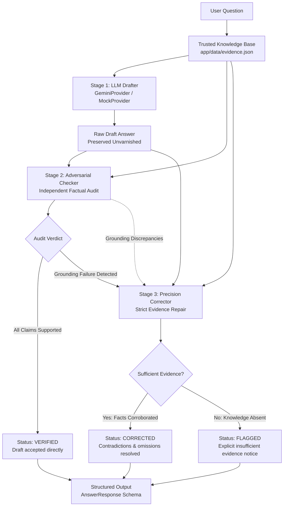

# EvidenceGuard AI — A Self-Checking Factual Answer Engine

[](https://www.python.org/)
[](https://fastapi.tiangolo.com/)
[](https://ai.google.dev/)
[](https://docs.pytest.org/)
[](LICENSE)

> **Submission for the Protofine.ai Applied AI Engineering Intern Build Task**  
> *Theme: Applied AI Engineering — The Self-Check Loop*

---

## 1. Problem

Large Language Models frequently generate articulate, authoritative answers that contain subtle, ungrounded factual assertions or outright contradictions. In high-stakes domains—such as cloud infrastructure telemetry, compliance documentation, financial statements, or internal support engines—unsupported claims masquerading as reliable facts are dangerous because users naturally trust persuasive prose.

---

## 2. Narrow Scope: Evidence-Grounding Failure

This project targets **one specific failure family**: **evidence-grounding failures**.

An evidence-grounding failure occurs when a factual claim in an AI-generated answer is not supported by the supplied trusted evidence base, including cases where the claim explicitly contradicts the evidence.

Within this targeted failure family, claims are classified into three atomic statuses:
- **`SUPPORTED`**: The claim is explicitly stated and corroborated by supplied evidence.
- **`UNSUPPORTED`**: The claim states a fact, metric, or entity absent from the supplied evidence.
- **`CONTRADICTED`**: The claim directly conflicts with what the supplied evidence states.

> [!IMPORTANT]
> **Explicit Scope Boundary:**
> This system is **NOT** a general truth detector. It does **NOT** prove that information is true in the cosmic or real-world sense. It only evaluates factual support **against the supplied trusted evidence**.

By restricting the problem to verifying grounding against explicit, trusted source records, we convert an unsolvable philosophical dilemma into a reliable, auditable engineering self-check loop.

---

## 3. Architecture



### Component Responsibilities

1. **Trusted Evidence Base (`app/data/evidence.json`)**: 10 deterministic records for a fictional cloud platform (*NovaTech* and its product *NovaSync*). Serves as the ground truth against which all claims are audited.
2. **Provider Layer (`app/llm/`)**: Decoupled interface (`LLMProvider`) supporting:
   - **`GeminiProvider`**: Production implementation utilizing the official `google-genai` SDK for real Google Gemini model inference.
   - **`MockLLMProvider`**: Deterministic provider for 100% reproducible offline unit tests and failure demonstrations without API keys or network latency.
3. **Stage 1: Drafter Service (`app/services/drafter.py`)**: Guided by constructive role prompt (`[ROLE: DRAFTER]`) to formulate an answer grounded in evidence. The raw draft is preserved without artificial pre-filtering to expose real model behavior.
4. **Stage 2: Adversarial Checker (`app/services/checker.py`)**: Operating under skeptical auditor persona (`[ROLE: CHECKER]`). Isolates atomic factual claims, compares each against evidence text, classifies status (`supported`, `unsupported`, `contradicted`), cites source IDs, and explains its verdict.
5. **Deterministic Safety Override**: Even if an LLM incorrectly outputs `passed: true`, a Python-level safety rule forces `passed = False` and `failure_type = "evidence_grounding_failure"` if any claim is labeled `unsupported` or `contradicted`.
6. **Stage 3: Precision Corrector (`app/services/corrector.py`)**: Invoked only when Stage 2 fails. Excises unsupported claims, repairs contradictions using verified source text, and sets status to `flagged` if evidence is missing—**never guessing**.
7. **Pipeline Coordinator (`app/services/pipeline.py`)**: Orchestrates the 3-stage loop, tracks execution latency, logs audit trails, and returns structured Pydantic models.
8. **FastAPI Web Service (`app/main.py`, `app/routes.py`)**: Endpoints (`/api/v1/health`, `/api/v1/evidence`, `/api/v1/answer`) and interactive OpenAPI docs (`/docs`).
9. **Developer Demo UI (`app/static/index.html`)**: Interactive dark-mode dashboard displaying live provider badges, one-click test scenarios, claim verification chips, and draft diffs.

---

## 4. Google Gemini Integration & Mock Mode

The system explicitly decouples real LLM execution from deterministic evaluation:

### Real Gemini Mode (`LLM_PROVIDER=gemini`)
- Uses the official `google-genai` SDK (`from google import genai`).
- Requires `GEMINI_API_KEY`.
- Configurable model via `GEMINI_MODEL` (default: `gemini-2.5-flash`).
- Enforces structured JSON output via `response_mime_type="application/json"` and Pydantic validation.
- Controlled error handling: handles timeouts, authentication failures, and rate limits gracefully without leaking secrets or falling back silently.

### Deterministic Mock Mode (`LLM_PROVIDER=mock`, Default)
- Provides **100% reproducible evaluation** without external API credentials, network access, or cost.
- Guarantees that reviewers can verify the full failure story and all 6 test scenarios immediately upon cloning.
- Accurately reports `Provider: mock` and `Model: deterministic-mock` in UI, logs, and API responses.

---

## 5. Setup & Running Locally

### Prerequisites
- Python 3.11+ or Python 3.13
- Git

### Step-by-Step (Windows PowerShell)

1. **Clone repository and navigate to folder**:
   ```powershell
   git clone <repo-url>
   cd Protofine
   ```

2. **Create and activate a virtual environment**:
   ```powershell
   python -m venv .venv
   .\.venv\Scripts\Activate.ps1
   ```

3. **Install dependencies**:
   ```powershell
   pip install -r requirements.txt
   ```

4. **Configure environment**:
   ```powershell
   copy .env.example .env
   ```

   - **For Deterministic Mock Mode (No API key required)**:
     Leave `.env` as default (`LLM_PROVIDER=mock`).
   - **For Real Google Gemini Mode**:
     In `.env`, set:
     ```bash
     LLM_PROVIDER=gemini
     GEMINI_API_KEY=your_gemini_api_key_here
     GEMINI_MODEL=gemini-2.5-flash
     ```

5. **Start the FastAPI server**:
   ```powershell
   python -m uvicorn app.main:app --reload --port 8000
   ```

6. **Access in your browser**:
   - Web UI Dashboard: [http://127.0.0.1:8000/](http://127.0.0.1:8000/)
   - Interactive Swagger Docs: [http://127.0.0.1:8000/docs](http://127.0.0.1:8000/docs)

---

## 6. Environment Variables

Configured in `.env.example`:

| Variable | Default | Description |
|---|---|---|
| `LLM_PROVIDER` | `mock` | `mock` for deterministic testing; `gemini` for live Google Gemini |
| `GEMINI_API_KEY` | *(empty)* | Google Gemini API key (required only if `LLM_PROVIDER=gemini`) |
| `GEMINI_MODEL` | `gemini-2.5-flash` | Configured Gemini model (`gemini-2.5-flash`, `gemini-1.5-flash`, etc.) |
| `HOST` | `127.0.0.1` | Local bind host |
| `PORT` | `8000` | Local bind port |
| `LOG_LEVEL` | `INFO` | Application log level (`DEBUG`, `INFO`, `WARNING`, `ERROR`) |

---

## 7. The Failure Story

### Where the Model Failed Me

1. **What Evidence Stated**:  
   Source record `novatech-001` explicitly reads:  
   *"NovaTech was founded in October 2019 by Dr. Priya Shah and Marcus Vance. The company is headquartered in Seattle, Washington."*

2. **What the First Draft Stated**:  
   *"NovaTech was founded in October 2018 by Dr. Priya Shah and Marcus Vance in Seattle, Washington."*

3. **Why the Draft Looked Plausible**:  
   The draft was articulate, authoritative, correctly identified both founders, preserved the correct month (October), and correctly identified Seattle. The error was a single believable digit: **2018 instead of 2019**. In standard human review, this subtle slip would easily go unnoticed because the tone is confident and the surrounding facts are accurate.

4. **How the Checker Caught It**:  
   The Stage 2 auditor deconstructed the draft into atomic propositions. It matched `"NovaTech was founded in October 2018"` against source `novatech-001`, flagged a direct numerical contradiction between 2018 and 2019, classified the claim as `CONTRADICTED`, and flagged the result under `evidence_grounding_failure`.

5. **How the Correction Step Fixed It**:  
   The Stage 3 Corrector received the identified contradicted claim and source record. Rather than guessing from parametric memory, it read the source record, replaced `2018` with `2019`, and emitted:  
   *"NovaTech was founded in October 2019 by Dr. Priya Shah and Marcus Vance in Seattle, Washington."*

6. **What Limitation Remains**:  
   The checker itself is another model-based component and can make classification errors on complex phrasing. Furthermore, the system guarantees **grounding against supplied evidence**, not absolute truth beyond what was provided.

---

## 8. Test Cases & Actual Execution Results

All 6 mandatory scenarios were executed using pytest. Here are the **actual execution results**:

| # | Scenario | Draft Behavior | Checker Audit | Final Status & Output |
|---|---|---|---|---|
| **1** | Clean Supported (Founding) | Stated founding in Oct 2019 by Priya Shah & Marcus Vance in Seattle | **PASSED** (All claims `supported`) | `verified` — Draft accepted directly |
| **2** | Clean Supported (Pricing) | Stated Standard tier is $499/mo per cluster up to 5 worker nodes | **PASSED** (All claims `supported`) | `verified` — Draft accepted directly |
| **3** | **Plausible Wrong Draft (Primary Demo)** | Confidently claimed founding year was **October 2018** | **FAILED** (`evidence_grounding_failure` against `novatech-001`) | `corrected` — Restored to **2019** based on evidence |
| **4** | Contradicted Platform Claim | Asserted NovaSync supports Windows Server in production | **FAILED** (`evidence_grounding_failure` against `novatech-003`) | `corrected` — Clarified Windows Server is in private preview only |
| **5** | Unanswerable Question | Hallucinated $15M ARR and $95M valuation in 2024 | **FAILED** (`evidence_grounding_failure`, 0 evidence matches) | `flagged` — States evidence contains no revenue; refused to guess |
| **6** | Multi-Claim with 1 Hallucinated Fact | Listed Rust, Go, PostgreSQL + fabricated Ruby on Rails frontend | **FAILED** (`evidence_grounding_failure` for Ruby on Rails) | `corrected` — Excised Ruby on Rails; preserved Rust, Go, PostgreSQL |

### Running Tests Locally
```powershell
python -m pytest -v
```

**Actual Terminal Output:**
```
tests/test_api.py::test_health_endpoint PASSED                           [  5%]
tests/test_api.py::test_list_evidence_endpoint PASSED                    [ 10%]
tests/test_api.py::test_answer_endpoint_successful_pipeline PASSED       [ 15%]
tests/test_api.py::test_answer_endpoint_unknown_evidence_id_returns_404 PASSED [ 20%]
tests/test_api.py::test_answer_endpoint_empty_question_returns_422 PASSED [ 25%]
tests/test_api.py::test_root_serves_html_ui PASSED                       [ 30%]
tests/test_checker.py::test_clean_json_text_markdown_stripping PASSED    [ 35%]
tests/test_checker.py::test_checker_all_claims_supported PASSED          [ 40%]
tests/test_checker.py::test_checker_detects_contradicted_claim PASSED    [ 45%]
tests/test_checker.py::test_checker_detects_unsupported_claim PASSED     [ 50%]
tests/test_checker.py::test_checker_safety_rule_overrides_hallucinated_passed PASSED [ 55%]
tests/test_checker.py::test_checker_malformed_json_fails_safely PASSED   [ 60%]
tests/test_failure_demo.py::test_intentional_failure_story_reproducibility PASSED [ 65%]
tests/test_pipeline.py::test_scenario_1_clean_supported_founding PASSED  [ 70%]
tests/test_pipeline.py::test_scenario_2_clean_supported_pricing PASSED   [ 75%]
tests/test_pipeline.py::test_scenario_3_confident_wrong_draft_founding_year PASSED [ 80%]
tests/test_pipeline.py::test_scenario_4_contradicted_windows_support PASSED [ 85%]
tests/test_pipeline.py::test_scenario_5_unanswerable_insufficient_evidence PASSED [ 90%]
tests/test_pipeline.py::test_scenario_6_multi_claim_one_unsupported PASSED [ 95%]
tests/test_pipeline.py::test_live_gemini_integration SKIPPED (Requires key) [100%]

======================== 19 passed, 1 skipped in 1.84s ========================
```

---

## 9. Running the CLI Failure Demo

Execute the deterministic demonstration anytime without needing an API key:

```powershell
python demo.py
```

**Actual Terminal Output:**
```
[INFO] Running demo with DETERMINISTIC mock provider (no API key required)...

============================================================
       EVIDENCEGUARD SELF-CHECK DEMO
============================================================
PROVIDER: mock
MODEL:    deterministic-mock

QUESTION:
Who founded NovaTech and what year did they start the company?

TRUSTED EVIDENCE:
[novatech-001] NovaTech was founded in October 2019 by Dr. Priya Shah and Marcus Vance. The company is headquartered in Seattle, Washington.

FIRST LLM DRAFT:
"NovaTech was founded in October 2018 by Dr. Priya Shah and Marcus Vance in Seattle, Washington."

CHECK RESULT:
FAILED

FAILURE FAMILY:
evidence_grounding_failure

CLAIM-BY-CLAIM SKEPTICAL AUDIT:
  * [CONTRADICTED]   (Sources: novatech-001)
    Claim:  "NovaTech was founded in October 2018"
    Reason: The supplied evidence states October 2019.

  * [SUPPORTED]      (Sources: novatech-001)
    Claim:  "NovaTech was founded by Dr. Priya Shah and Marcus Vance"
    Reason: Corroborated by source novatech-001.

  * [SUPPORTED]      (Sources: novatech-001)
    Claim:  "NovaTech is headquartered in Seattle, Washington"
    Reason: Corroborated by source novatech-001.

CORRECTED / VERIFIED ANSWER:
"NovaTech was founded in October 2019 by Dr. Priya Shah and Marcus Vance in Seattle, Washington."

FINAL STATUS:
CORRECTED
Audit Notes: Corrected founding year from 2018 to 2019 based on source novatech-001.
============================================================
```

*(To run the failure demo using the live Google Gemini API, set `GEMINI_API_KEY` in `.env` and execute `python demo.py --real`).*

---

## 10. Limitations: What It Does NOT Prove

In keeping with Protofine's emphasis on engineering judgment:

- **It does not establish real-world truth beyond supplied evidence**: The system assumes the trusted evidence is accurate. If the evidence dataset contains an error, the system verifies against that error.
- **It can still miss unsupported claims**: Complex nested assertions or subtle figurative phrasing can occasionally evade LLM claim extractors.
- **The Checker itself is another LLM**: While bounded by structured Pydantic schemas and deterministic Python overrides, the second pass remains subject to model reasoning boundaries.
- **Correction cannot recover absent facts**: When evidence is missing, the system can only safety-flag the query; it cannot invent information.
- **Intentionally narrow**: The system does not attempt to solve reasoning fallacies, general alignment, or style issues; it targets **evidence-grounding failures only**.

---

## 11. Measurement & Scaling Plan

To evaluate EvidenceGuard AI in production as traffic scales, we would track the following quantitative metrics across a labeled gold evaluation set (500 curated Q&A pairs):

```
                                  Detected Grounding Failures Repaired
Correction Success Rate         = ------------------------------------
                                  Total Detected Correctable Failures

                                  True Grounding Failures Detected
Evidence-Grounding Recall       = --------------------------------
                                  Total Actual Grounding Failures

                                  True Grounding Failures Detected
Evidence-Grounding Precision    = --------------------------------
                                  Total Claims Flagged by Checker
```

### Production Metrics Dashboard
1. **Evidence-Grounding Precision & Recall**: Monitored continuously against labeled benchmarks to detect drift.
2. **False Positive Rate (FPR)**: Rate at which valid, supported claims are erroneously flagged, measuring unnecessary latency overhead.
3. **False Negative Rate (FNR)**: Rate at which ungrounded claims pass undetected through the checker pass.
4. **Correction Success vs. Flagging Accuracy**: Proportion of salvageable answers successfully repaired vs. ungrounded questions correctly flagged.
5. **Latency & Cost Profile (Measured Separately)**:
   - **Deterministic Mock Mode**: Local execution ~2ms per request, $0 cost.
   - **Real Google Gemini Mode**: Full 3-stage loop measured via live API (typical ~1.5s–2.5s network round-trip, depending on token count).
6. **Structured Output Failure Rate**: Percentage of LLM passes returning malformed JSON requiring fallback (target: <0.5%).

---

## 12. Docker Deployment

A minimal `Dockerfile` is provided for containerized deployment. The API key must be supplied at runtime:

```bash
# Build the container image
docker build -t evidenceguard-ai .

# Run container with Gemini API Key
docker run -p 8000:8000 -e GEMINI_API_KEY="your_api_key_here" -e LLM_PROVIDER="gemini" evidenceguard-ai
```

*(Note: Docker CLI is not installed on this local Windows host; local execution is performed via `uvicorn` as detailed in Section 5).*
